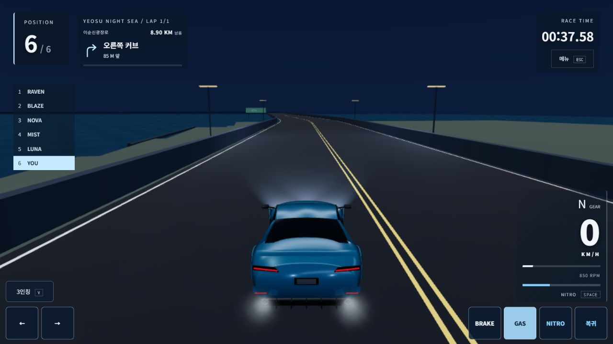

# AI 벽 접촉·정체 탈출 · 2026-10-26

브랜치 `codex/korea-circuits-progression-20261011`, HEAD `7f75155`에서 로컬 작업했다. 현재 주행 물리·충돌면·경로·메달·난이도 계수와 기존 사용자 변경은 보존했다. 새 커밋·푸시·PR·main 병합·운영 배포는 하지 않았다.

## 범위와 원인 근거

P1인 ‘AI가 벽에 비스듬히 끼거나 정차 차량에 붙은 뒤 출발하지 못함’을 먼저 다뤘다. 새 그래픽·물리 후보를 제품에 다시 넣지 않았다.

- 시작 시 직전 전체 통과본과 제품/시험 입력224개가 같은지 SHA로 확인했다. 변경 전 사본/mtime/SHA는 [inputs-before.json](../artifacts/ai-unjam-20261026/inputs-before.json)과 `before/`에 보존했다.
- 보류된 핸들링 후보를 별도 폴더에서 그대로 재생했다. NOVA는369초에 경로와 약131° 틀어져 벽 접촉 중0.13km/h였지만 throttle=1/steer=1을 계속 받았다. BLAZE도541초에 약85°로 벽에 끼고, RAVEN이 바로 뒤에서 브레이크를 유지했다. [첫 벽 관측](../artifacts/ai-unjam-20261026/coastal-candidate-stall-v2.json) · [최종 정체 관측](../artifacts/ai-unjam-20261026/coastal-candidate-stall-v3.json).
- 기존 AI는 전진 조향/제동과9m 이상의 추월 공간을 전제로 했다. 벽에 걸린 방향을 후진으로 고치거나, 충돌 후 짧아진 차간 거리를 다시 벌리는 절차가 없었다.
- 후진 증명 초안도 이미 침범한 ‘안전 여유’ 때문에 멀어지는 동작을 막는 반례가 있었다. 더 가까워지는 경로는 막고 이미 줄어든 여유에서 멀어지는 경로는 허용하도록 고쳤다.

## 적용

- `rivalRecovery.js`: 2.5초 이상 수평 이동이 거의 없고 방향이 크게 틀어지거나 앞차가9m 안에 멈춘 경우에만 후진을 검토한다. 보행 속도로 최대5초/6m 안에서 후진하고, 정지한 뒤 기존 차로 계획으로 돌아간다. 일반 주행/사람/완주 차량/공중에서는 시작하지 않고 일시정지 dt=0에서 상태도 바뀌지 않는다.
- `recoveryRoad.js`: 실제 차체 위치·방향에서 네 바퀴의 아스팔트/법선, 차체 크기의 후진 곡선, 벽과 후방 차량의 예측 위치를 검사한다. 움직이는 뒤차나 도로 끝을 무시하지 않는다. 이미 붙은 여유에서 더 멀어지는 동작만 허용한다.
- `overtakeRoad.js`가 실제 Rapier 도로 검증 기능을 제공할 때만 활성화한다. 기존 추월 증명과 차간 거리 기준은 그대로다. 일반 주행에서는 형상 쿼리를 실행하지 않는다.
- 새 조작은 조향·후진·브레이크 페달뿐이다. 차체 transform/속도/진행 거리를 쓰거나 순간이동·러버밴딩을 하지 않는다. 물리 지지 고정·타이어/조향 계수·라이벌 성격·메달을 바꾸지 않았다.

## 실제 측정

| 조건 | 변경 전 | 수정 후 |
|---|---:|---:|
| 관측된 NOVA 벽 자세, 현재 안정 물리로12초 주행한 경로 거리 | −3.62m | 70.49m |
| 같은12초 시점 속도/이탈 | 약12km/h / 이탈0 | 51.07km/h / 이탈0 |
| 5m 간격 압축 대열에서 AI5대가 정차 플레이어 통과 | 새 합성 반례 | 20.525~37.775초, 차체 접촉0 |
| 같은 정체 시험 최대 절대횡위치/최저 높이 | — | 2.201m / 0.511m |
| 보류 후보의 해안 쉬움3랩, 동일1260초 제한 | AI4대 미완주 | 6대604.24~642.46초 완주 |

마지막 행은 제품에 넣지 않은 물리 후보를 별도 폴더에 둔 교차검증이다. 제품의 핸들링 개선 수치나 후보 전체 승인 근거로 쓰지 않는다. 후보 스트레스의 최소 지면 높이 차이는0.08m였고 이탈0이었지만, 기존 여수 후보 실패2건을 전부 다시 검증한 것은 아니다. [원시 결과](../artifacts/ai-unjam-20261026/candidate-physics-stress.json).

첫 관련 시험41/41, 첫 전체 `npm run check`는516/516·웹 빌드8.66초로 통과했다. 안전 여유 보완과 압축 대열 영구 회귀 시험까지 포함한 **최종 전체517/517·웹 빌드16.68초도 통과**했다. 단언 완화/생략/취소0, 기본 concurrency2와 Node heap384MiB를 사용했다. 최종 명령1773.806초(시험1743.240초). [최종 로그](../artifacts/ai-unjam-20261026/npm-check-final.log) · [명령 결과](../artifacts/ai-unjam-20261026/npm-check-final-result.json).

맑음24·비14·교통6대 포함3조건, 합계 **41레이스246대 전원 완주·이탈0·노면 아래 추락0**이다. 모든 차량의 기록이 직전 안전본과 같았다(최대 시간 차이0초). 난이도 중간값 순서·기존 메달 계약도 전체 검사에서 통과했다. Windows 로컬 CPU/Rapier WASM이며 Colab을 사용하지 않았다. 원시 시험의 오래된 Colab 문자열을 이번 장치 근거로 쓰지 않는다. [조건별 시간·높이·비교](../artifacts/ai-unjam-20261026/race-regression-final.json).

## 실제 브라우저·성능

최종 소스 DEV 남악 보통6대가 전부 완주했다. 플레이어1:25.73·동메달/해금 표시와 결과→차고 복귀를 확인했다. [직접 확인한 결과](../artifacts/ai-unjam-20261026/screens/namak-finish.png). 수동 실제 휴대폰 검증과 구분한다.

무거운 CPU 검사를 끝낸 뒤 같은 IAB 탭·1280×720/DPR.75·남악 낮음·맑음·보통6대·추격 카메라·표준 모션·고스트 끔에서 A/B/A를 각각30초 이상 측정했다. GPU timer/frozen/profile 훅은 끈 상태다. 격리된 개발 서버 두 곳에 같은 읽기 전용 진단 버튼만 두고 측정 후 눌렀으며, 별도 반복 수집 루프나 물리 상태 변경은 없다. 개발 모드 비교이고 운영/실기기 장시간 FPS 주장이 아니다.

| 조건 | 평균/p95/최대 ms | 50ms 초과 | CPU 제출 평균/p95/최대 ms |
|---|---|---:|---|
| A1 변경 전 | 17.192 /17.0 /66.5 | 2 | 7.571 /11.5 /43.7 |
| B 수정 후 | 16.949 /16.9 /65.9 | 1 | 6.730 /9.8 /30.5 |
| A2 변경 전 | 17.211 /17.0 /50.1 | 1 | 7.943 /12.9 /42.4 |

전부 시야/포커스 이탈0·버린 시뮬레이션0, 마지막 진행829.811m로 같다. p95 +2ms 악화 제한 안이다. **수정본에도65.9ms 한 프레임은 남았고 표본을 지우지 않았다.** 작은 차이를 일반 성능 개선으로 단정하지 않는다. [요약·드로·조건](../artifacts/ai-unjam-20261026/performance-summary.json) · 원시는 같은 폴더의 performance-a1/b/a2.json.

별도로 실제 해안 충돌면/정지한5대의 계획 CPU만 비교했다. 수정본 단계 평균0.090/p950.913/최대3.860ms, 원본 A1은0.020/0.046/1.390ms, A2는0.011/0.019/0.607ms였다. 3600스텝 중 복귀 증명768회, 처음600스텝을 동일하게 예열한 뒤3000개를 기록했다. 이는 정체 시의 추가 비용이며 렌더링 FPS와 합산하거나 ‘비용 없음’으로 표현하지 않는다. [원시](../artifacts/ai-unjam-20261026/blocked-queue-planner-cost.json).

## 용량·보존

- 웹 배포 파일37개: 80,118,796→80,123,274B(+4,478B), 같은 text 확장자/gzip level9 범위2,128,649→2,130,243B(+1,594B). [같은 기준 전후](../artifacts/ai-unjam-20261026/build-footprint-final.json).
- 최종 웹 빌드 여수 차고 첫20리소스 encoded21,194,088B·transfer21,200,088B·cache0·크기 미상0. 직전21,192,494B 대비+1,594B. HTML·음악·다른 코스는 제외한 Resource Timing 값이고 모바일망 로딩 시간 주장이 아니다. [실제 초기 상태](../artifacts/ai-unjam-20261026/production-initial.json).
- 물리/코스 핵심14개와 공개 자산29개는 Git HEAD 계약과 같고, 블로그20장은 image-index SHA와 같았다. 최종 제품/시험 입력227개가 검사한 격리본과 SHA까지 같았다. [보존 근거](../artifacts/ai-unjam-20261026/preservation-final.json). 사용자 자료/비밀키는 읽거나 지우지 않았다.

## 실패와 바로잡은 검사

- 첫 진단은 촬영 시작 전 정차를 감지해 빈 행을 저장했다. 그 파일을 보존하고 앞선80초를 항상 기록하도록 고쳤다.
- 압축 대열의 첫 합성 시험은 AI5대가 접촉 없이 전부 통과했지만, 먼저 통과한 차가 짧은 시험장 바닥 끝(z=400m)을 지나 떨어져 높이 단언에서 실패했다. 선언한4km 경로 전체를 덮도록 시험장만 고쳤다. 제품 도로/충돌과 높이·접촉 단언은 그대로다. 재시험 최저0.511m·접촉0. [실패 원시](../artifacts/ai-unjam-20261026/compressed-queue-second.json) · [바로잡은 시험](../artifacts/ai-unjam-20261026/compressed-queue-corrected.json).
- 관련 시험을 원본 폴더에서 처음 실행할 때 기존 테스트가 역사적 full-course 보고서를 덮어썼다. 새 결과는 작업 폴더에 보존하고 검사 전 복사/해시 확인한 파일로 원래 보고서를 바이트까지 복구했다. 이후 전체 검사는 격리 폴더에서만 실행했다.
- 첫 브라우저 제어 커널이 종료되어 재연결했다. 무거운 검사와3D 탭이 겹쳤을 때 메모리가315MiB까지 줄어 검수 탭을 닫았다. 이 상태를 성능 표본으로 사용하지 않는다. 사용자 앱/자료는 닫거나 지우지 않았다.

## 최종 운영 웹 빌드의 화면·입력

[현재 로컬 검수본](http://127.0.0.1:5210/?track=yeosu)은 최종 전체 검사를 통과한 dist를 그대로 제공한다. 차고에서 바로 시작할 수 있도록 화면을 열어 두었다. 운영 서버에는 반영하지 않았다.

- 1280×720 /1024×768 /844×390 /667×375에서 터치 버튼6개, 최소68/57.6/44/44px, 버튼 잘림0·버튼 간 겹침0·선택한 HUD와 겹침0을 실측했다. 각 크기에서 주행 재개 상태·입력 전부0을 확인했다. 844 전환으로 나타난 일시정지에서 실제로 재개했다. [최종 실측](../artifacts/ai-unjam-20261026/ui-clean-sizes.json).
- 초안 캡처에는 개발용 진단 버튼이 시계 위에 있었다. 최종 캡처와 위 실측은 **진단 파라미터 없는 정상 주소**로 다시 검사한 결과다. 제품 UI를 수정하거나 가려서 통과시킨 것이 아니다. 기존 DOM의 data-telemetry를 읽었으며 외부에서 물리 상태를 쓰지 않았다.
- 실제 웹 빌드에서 키보드/포인터 가속 입력에1~4km/h의 짧은 응답, 메뉴 열기·재개·화면 변경·시점 전환 뒤 입력0을 확인했다. 자동화의 durationMs 홀드 요청은 기대한 가속 지속 시간과 일치하는지 확인할 수 없어, 이 값을 정량 가속/0→100 시험으로 쓰지 않는다. 원시 키/포인터 표본을 보존했다. 사람의 연속 운전과 실제 모바일 멀티터치는 남았다.
- 1인칭/3인칭 전환과 메뉴→차고 복귀를 확인했다. 콘솔 실행 오류0, 여러 로딩/전환에서 기존 종류의 WebGL 셰이더 정밀도 경고5개가 수집됐다. 빌드의 큰 JS chunk 경고도 남았다. [브라우저 상태](../artifacts/ai-unjam-20261026/production-browser-final.json) · [복귀](../artifacts/ai-unjam-20261026/production-flow-final.json) · [콘솔](../artifacts/ai-unjam-20261026/browser-console.json).

## 남은 위험과 다음 우선순위

실제 휴대폰/태블릿과 다른 통신망 온라인 충돌 검수는 별도다. 후방에 공간이 없거나 도로 증명이 실패하면 기다리며, 완전히 막힌 도로에서 무조건 탈출한다고 보장하지 않는다. 현재 안정 물리에서 사람이 벽/대열에 부딪혔을 때 AI 복귀 체감을 먼저 확인해야 한다. 보류한 접지/드리프트 후보는 여수 교통 실패2조건을 포함해 별도 검증하기 전까지 제품에 복원하지 않는다. 간헐적인65.9ms 프레임과 높은 품질/실기기의 장시간 비용도 남았다.

이번 작업은 AI 진행 차단을 먼저 고친 단계다. 새 Blender 차체/도로·배경 자산을 제작하거나 AAA 그래픽 완성을 주장하지 않는다. 기존 야경/차량 반사 개선은 보존했다.
