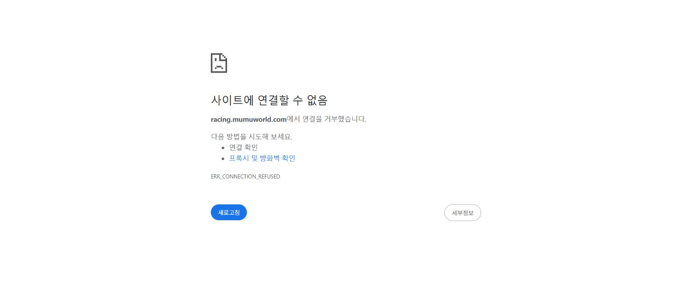

# 사용자 Chrome 공식 주소 접속 실패 · 2026-10-14

**공식 주소의 사용자 Chrome 접속은 아직 해결되지 않았다(P0).** 앞선 Codex 내장 브라우저의 성공을 사용자 Chrome의 접속 성공으로 확대해 보고한 판단을 정정한다. 내장 브라우저 검증은 실제 사용자 브라우저 검증을 대신할 수 없다.

## 이번에 직접 확인한 사실

| 검사 | 결과 |
| --- | --- |
| 사용자의 기존 Chrome 탭 | `https://racing.mumuworld.com/`, `ERR_CONNECTION_REFUSED` 직접 재현 |
| Windows DNS / Node OS lookup | 공식 hostname → `127.0.0.1` |
| 독립 Node c-ares 질의 | `1.1.1.1`, `8.8.8.8` 모두 같은 hostname에 `127.0.0.1`, TTL 3600 반환 |
| Windows NoHostsFile/DnsOnly, DNS 서버 5개 지정 | 모두 공식 hostname에 `127.0.0.1` 반환 |
| 부모 도메인·기본 Worker hostname | 공용 Cloudflare IP 반환. 공식 hostname과 결과가 다름 |
| 로컬 공식 `/release.json` | `ECONNREFUSED`, 연결 대상 `127.0.0.1` |
| 같은 PC 기본 Worker `/release.json` | HTTP 200, 소스 `4359d7d` |
| **같은 사용자 Chrome**, 기본 Worker 주소 | 남악 차량 차고 로딩 완료·조작 버튼 활성화 |
| Google DoH HTTPS 공개 조회 | Chrome은 연결 거부, 로컬 Node는 시간 초과. 이 PC에서 사용 가능하다고 가정하지 않음 |
| Chrome 설정 확인 | 자동화 도구가 `chrome://settings/security`를 URL 보안 정책으로 거부. 우회하지 않음 |

앞선 Wrangler 원격 DNS/35파일 검사는 `artifacts/domain-repair-20261014/`에 보존된 이전 실행이다. 이번 검사의 신규 결과로 계산하지 않았다. 서버 소스·Cloudflare custom domain·인증서·게임 파일을 다시 변경하지 않았다.

## 원인 판정과 조치 범위

- **확정:** 사용자 접속 실패와 잘못된 로컬 DNS 응답이 재현된다. 현재 조회는 게임 서버 대신 loopback을 향한다. 동일 게임의 다른 hostname은 같은 Chrome에서 로딩된다.
- **미확정:** 잘못된 응답이 통신망 DNS, 로컬 네트워크/보안 소프트웨어, 관리 정책 중 어디에서 생기는지 아직 구분하지 못했다. Chrome 캐시만의 문제 또는 Cloudflare 원본 DNS 오류라고 단정하지 않는다.
- 임의 hosts 고정, DNS 서버 변경, 보안 제품/조직 정책 해제, TLS 검증 해제, Chrome 내부 페이지 접근 정책 우회는 수행하지 않았다.
- 사용자가 **조직에서 관리하여 Chrome 보안 DNS 설정 변경 불가**라고 답했다. 이후 요청대로 Wrangler 서비스 삭제·재생성을 실행했지만 공식 주소의 Chrome 실패는 유지됐다. [최신 재생성·검증 보고](CLOUDFLARE_RECREATE_20261014.md)와 [관리자 점검 요청서](NETWORK_ADMIN_REQUEST_20261014.md)를 따른다.
- Chrome 내부 페이지에 대한 자동 제어 거부는 도구의 접근 제한이다. 실제 게임의 `ERR_CONNECTION_REFUSED`와 별개의 사건으로 기록한다.

## 현재 사용 가능한 주소와 완료 기준

같은 Chrome에서 확인한 임시 플레이 주소는 [기본 Worker 주소](https://mumu-circuit.reinhardt7177.workers.dev/?track=namak&v=4359d7d)다. 사용자가 요구한 공식 hostname의 해결을 대체하지 않는다.

완료 기준은 **사용자 Chrome에서 `racing.mumuworld.com`을 유지하며 차고 로딩·출발·입력·복귀를 확인하는 것**이다. 그 전까지 ‘접속 해결 완료’로 보고하지 않는다.

이번에는 게임 코드/물리/UI 변경이 없으므로 전체 회귀·레이스·성능 검사를 다시 실행하지 않았다. 문서·검사 스크립트의 구문, 기록과 diff만 검증한다. main/PR/병합/새 배포는 없다. 사용자와 다른 편집자의 남악 작업도 보존한다.

## 증거와 참고

- 새 증거: `artifacts/chrome-access-20261014/dns-path-probe.json`, `browser-comparison.json`.
- 변경 전 문서는 같은 폴더의 `before/`에 보존했다. 원격 성공과 로컬 실패 표본도 유지했다.
- Chrome 보안 DNS의 UI 경로·자동 fallback·관리 기기 제한은 [Google 공식 데스크톱 안내](https://support.google.com/chrome/answer/10468685?co=GENIE.Platform%3DDesktop&hl=ko)를 확인했다. 설정 변경을 아직 적용하지 않았다.

