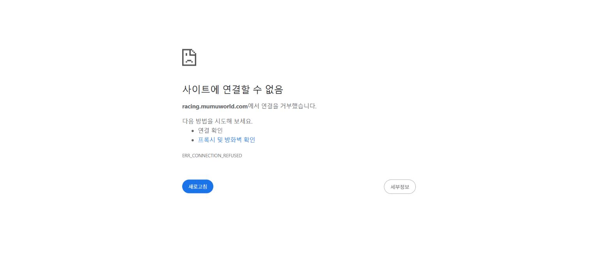
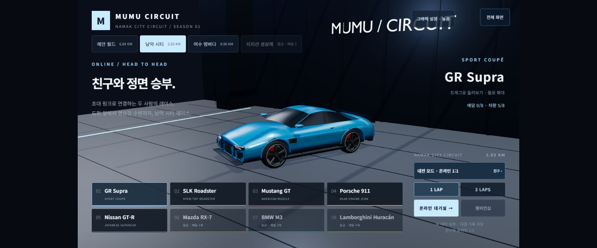

# Cloudflare 게임 서비스 삭제·재생성 · 2026-10-14

**요청한 Wrangler 초기화와 재배포는 완료했다. 사용자 Chrome의 공식 주소 접속은 여전히 미해결이다.** 조직 관리 환경이라는 사용자 답변을 기록했고, 서버 재생성이 이 PC의 DNS 오류를 해소했다고 주장하지 않는다.

## 실행 범위와 복구 준비

- 삭제 대상은 이번 게임의 Worker `mumu-circuit`과 연결된 `racing.mumuworld.com`이었다.
- 삭제 전 도메인은 정확히 1개였다. Service Binding·Pages Function·다른 Durable Object·Dispatch·Tail 의존은 모두 0/없음이었다.
- 실제 배포 중인 게임 소스 `4359d7dee328e94b6dc2c11d2e278bbaf6167043`의 35파일/78,686,994 bytes를 별도 `backup-dist/`로 복사하고 원본 및 사본의 SHA-256을 모두 검증했다.
- 복구용 config의 `wrangler deploy --dry-run`을 먼저 통과시켰다.
- 로컬 소스·GitHub 저장소·다른 Cloudflare 서비스·부모 zone을 삭제하지 않았다. 다른 편집자의 남악 작업, 브라우저 게임 저장 상태를 보존했다.

## 실제 삭제 및 신규 생성

1. Wrangler 4.149.0의 **일반 `delete mumu-circuit`**를 실행하고 대상 이름이 일치하는 확인 문항에 응답했다. `--force`는 사용하지 않았다.
2. CLI의 `Successfully deleted mumu-circuit`를 확인했다. 바로 다음 API 조회의 소유 도메인 목록은 **빈 배열**이었다.
3. 검증된 사본으로 `wrangler deploy`를 실행해 **35개 파일 모두 신규 업로드**했다. 명시한 zone에 공식 custom domain을 재등록했다.
4. 신규 활성 버전은 **`d63542c0-5ae9-478d-93c8-1d74fec2cba0` / 100%**다. 새 Worker의 deployment history는 1개다. 기존 활성 버전 `156f359b-4940-4d49-9df3-c767bd880d9f`의 서비스 이력을 재사용하지 않았다.
5. 최종 도메인은 1개·`enabled: true`였으며 신규 인증서 ID가 할당됐다. 의존 서비스도 다시 0/없음을 확인했다.

Wrangler 보고 시간: 파일 업로드 8.93초, Worker 업로드 12.12초, triggers 배포 1.54초. 이 숫자는 각 CLI 단계 값이며 전체 서비스 중단 시간이나 모든 지역의 전파 시간을 뜻하지 않는다.

## 초기화 후 새로 실행한 검증

| 항목 | 결과 |
| --- | --- |
| 공식 공개 파일 | **35/35 HTTP 200·바이트·SHA-256 일치**, 78,686,994 bytes |
| 네 코스 HTML | 해안·남악·여수·성삼재 HTTP 200, 정확한 JS entry |
| 없는 모델 | HTTP 404 |
| 공개 DNS | 원격 Cloudflare·Google 모두 공용 Cloudflare IP 반환, TTL 300 |
| 새 배포 상태 | CLI deployments 1개, 신규 버전 100% |
| Windows DNS 캐시 초기화 후 조회 | **여전히 `127.0.0.1`** |
| 로컬 공식 release | `ECONNREFUSED`, 대상 `127.0.0.1` |
| 로컬 기본 Worker release | HTTP 200, 정확한 소스 `4359d7d` |
| 사용자 Chrome 공식 주소 새 탭 | **`ERR_CONNECTION_REFUSED`** |
| 사용자 Chrome 기본 Worker 새 탭 | 실제 차량 차고·버튼 로딩 완료, 콘솔 오류/경고 **0/0** |

파일/DNS 검증은 Wrangler 임시 remote preview의 공개 요청으로 실행했다. production 진단 Worker를 생성하지 않았고 자신이 시작한 dev 프로세스는 종료했다. 토큰·인증 파일을 직접 읽거나 출력하지 않았다. 위 표는 이번 재생성 후 새 실행이며 이전 검사 숫자를 재사용한 것이 아니다.

이번 변경은 호스팅 초기화다. 게임 코드가 동일한 정확한 35파일을 재업로드했으므로 긴 전체 회귀·물리·프레임 검사는 다시 실행하지 않았다. Chrome의 새 기본 Worker 검사도 차고 로딩 범위이며 레이스 완주나 온라인 1:1 검증이 아니다.

## 남은 원인과 가장 중요한 다음 조치

- 새 서비스/연결과 공식 공개 파일은 정상이다. Cloudflare Worker의 기존 배포 이력이 꼬인 것만으로는 이번 Chrome 실패를 설명할 수 없다.
- 실패 환경의 조회는 계속 loopback을 반환한다. 이 응답을 만드는 위치가 통신망 DNS, 로컬 보안 제품, 관리 정책 중 어디인지 관리자 로그 없이 확정할 수 없다.
- 사용자가 **조직 관리로 Chrome DNS 설정 변경 불가**라고 확인했다. hosts·DNS 제공업체·조직 정책·보안 보호를 우회하거나 해제하지 않았다.
- 다음은 [관리자 점검 요청서](NETWORK_ADMIN_REQUEST_20261014.md)로 해당 hostname의 정책/조회 로그와 서비스 허용 가능 여부를 확인하는 것이다. 요청서는 로컬 문서로만 작성했고 발송하지 않았다.
- 완료 기준은 사용자 Chrome에서 `racing.mumuworld.com` 주소를 유지하며 차고→출발→복귀를 확인하는 것이다. 아직 그 기준을 만족하지 않는다.

증거: `artifacts/cloudflare-recreate-20261014/`의 `backup-manifest.json`, `inspect-before.json`, `inspect-deleted.json`, `inspect-after.json`, `delete.log`, `redeploy.log`, `deployment-summary.json`, `remote-public-assets.json`, `local-after.json`, `browser-after.json`. 재생성 config와 검사 스크립트를 보존했다. 정적 파일 사본·변경 전 문서·계정 메타데이터 전체 로그는 로컬에만 보관한다.

