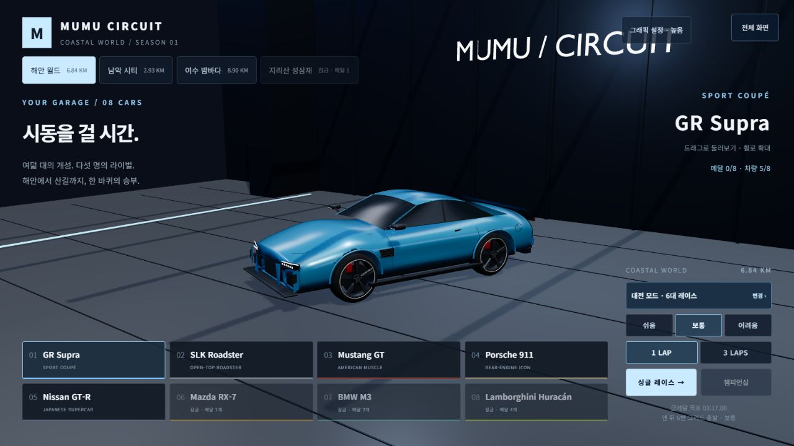

# 네 코스 최적화·안내 GitHub·운영 배포 · 2026-11-04

사용자가 최신 최적화·안내 수정의 GitHub 업로드와 `racing.mumuworld.com` 배포를 요청했다. 같은 브랜치 `codex/korea-circuits-progression-20261011`에서 진행하며 main/PR/병합과 도메인·DNS·보안 설정 변경은 하지 않는다.

## 배포 준비

- [변경·전체 검증·미해결 범위](MAP_POLISH_RESUME_20261104.md). 성삼재·남악·공통 장식 계산 재사용, 다음 독립 커브와 고속 예고, 모바일 글자·제동 버튼 대비·안내/순위표 겹침 수정이다. 안정 물리/AI/메달/모델/음원/경로는 그대로다.
- 직전 전체549/549·41레이스246대 완주 검사본과 현재232입력 SHA가 모두 같다. 이번 배포 준비에서는 관련 **46/46·재빌드5.68초**를 새로 실행했다. 전체549를 이번 배포 중 다시 실행한 것으로 표현하지 않는다.
- 전체 정적37파일80,129,012B. 배포 준비의 새 빌드가 검증한 로컬 배포물과 같은지도 확인한다.
- 원시 프레임의 나쁜 표본·실패와 수정·회귀 기록·화면을 함께 보존한다. 변경 전 사본·개인 PC hosts 백업·QA 전용 실행기·자격 증명은 업로드 대상에서 제외한다. PC DNS 복구 문서는 설명만 포함하며 실제 시스템 설정/인증 파일은 포함하지 않는다.

**현재 상태: GitHub 업로드와 Vercel Production 배포 완료. 공식 주소에서 새37파일 및 실제 게임 실행을 확인했다.**

- [공식 게임](https://racing.mumuworld.com/) · [여수 최신 버전](https://racing.mumuworld.com/?track=yeosu&v=a1bf9ce) · [GitHub 앱 코드 a1bf9ce](https://github.com/reinhardt7177-lab/three-rapier-idiom-racer/commit/a1bf9ceffdf01a633f12b12efb472094113d0755).
- Production **dpl_C6fBbr7DFomM1efmnTK2KuLbovgh / Ready**,2026-11-04 **12:02:01 KST**,Duration17초·Build Logs14초·도메인 할당1초. 고유 주소 mumu-racing-5nbx93cbv-reinhardt7177-labs-projects.vercel.app. Source는 앱 커밋 a1bf9ce다.
- 기존 브랜치에 코드·시험·문서·원시 검증108파일을 선택 업로드했다. GitHub 원격 SHA 일치와 비밀키 고신뢰 패턴0·100MiB 초과0을 확인했다. 개인 PC hosts/인증 파일·변경 전 사본·QA 실행기는 제외했다.

## 실제 진행

Preview dpl_BpT9A1LJs5KQ9moKTU2Ni6p5EGpR가11:53:43 KST/12초/Ready가 된 후, 같은 Source를 일반 Redeploy→Production으로 재빌드했다. 연결 도메인 mumu-racing.vercel.app과 racing.mumuworld.com을 확인했다. Vercel의 이번 액션 재인증은 사용자가 현재 창에서 직접 마쳤고, 이후 새 Production Ready를 확인했다. 인증값은 읽거나 저장하지 않았다. main/PR/병합·DNS/hosts·보안 설정은 변경하지 않았다.

## 배포 후 실행한 검증

- IP 강제 지정·인증서 무시 없이 공식 주소 일반HTTPS200. **37/37 HTTP200·35파일 SHA/바이트 일치+2파일 CRLF/LF 차이만·설명되지 않은 내용 차이0**. 전체 응답 본문80,128,650B.
- 네 코스 HTML200, 실행 JS index-Bq9WWtxS.js/CSS index-B4-cr3qt.css 일치, 누락GLB404. 기본 Vercel 운영 주소도HTTP200/새 실행 번들 SHA 일치다.
- 공식 주소에서 차고→여수 출발, 키보드53/포인터46km/h,1인칭 전환, 수동 도로 복귀4접지, 브레이크 정차0km/h, 키·포인터 해제 입력0, 차고 복귀 확인. 콘솔 오류0건.
- 네 IAB 크기1280×720/1024×768/844×390/667×375에서 터치 버튼7개·최소68/57.6/44/44px·중앙 hit7/7,HUD 겹침/가로 넘침0,화면 변경 후 입력0. Brake 글자는 어두운 배경에서 밝게 표시된다. 이번 공식 사이트의 초기 여수 구간에는 다음 커브 보조줄이 없었으며, 그 보조줄의 실제 도로·네 크기 검증은 동일 소스 로컬 기록과 구분한다.
- 터치 강제 표시를 자동으로, 카메라를3인칭으로 복원하고 뷰포트 오버라이드를 해제했다. 최종 탭은 쿼리 없는 공식 기본 주소의 차고,ready=true·입력0·새 실행 번들이다. 진행 데이터는 지우지 않았다.
- 기본 좁은 패널467×668(게임영역약467×263)의 차고에서도8차종 중앙hit8/8을 추가 관찰했다. 이것은 전체 세로 UI·200% 확대·실기기 검증을 완료했다는 뜻은 아니다.

## 검증 범위와 남은 작업

배포 준비의 새46시험/재빌드와 이전 전체549시험의232입력 내용 일치, 그리고 배포물37파일 내용 일치를 확인했다. 이번 재인증 재개 중 전체549를 다시 실행하거나 장시간 FPS를 측정하지 않았다. 높은 품질의 간헐적 긴 프레임·실제 휴대폰/태블릿의 전체 랩과 동시 입력·별도 통신망 온라인 검증은 남았다.

증거는 artifacts/deploy-map-polish-20261104/의 production-ready.json,official-verification.json,default-alias-verification.json,official-flow.json,official-ui.json,official-errors.json,official-final-state.json과 배포 준비 기록이다. 인증 대기 원본 기록도 보존했다. 화면은 로컬 D:/racing/.work/deploy-map-polish-20261104/screens/에 보존했으며 블로그 대표20장은 변경하지 않았다.

