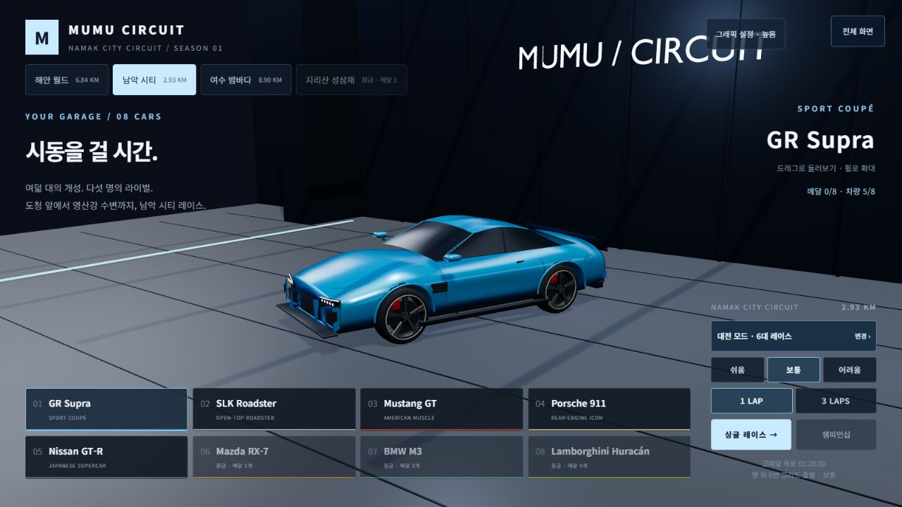
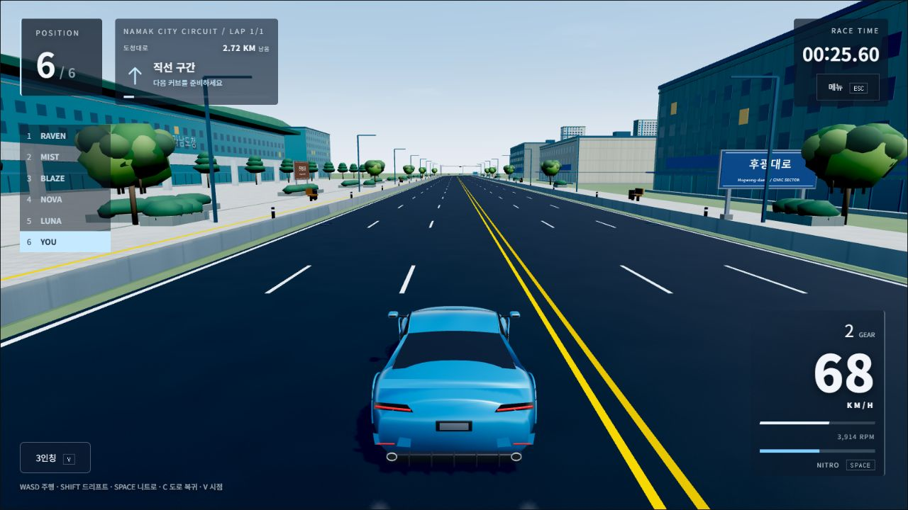
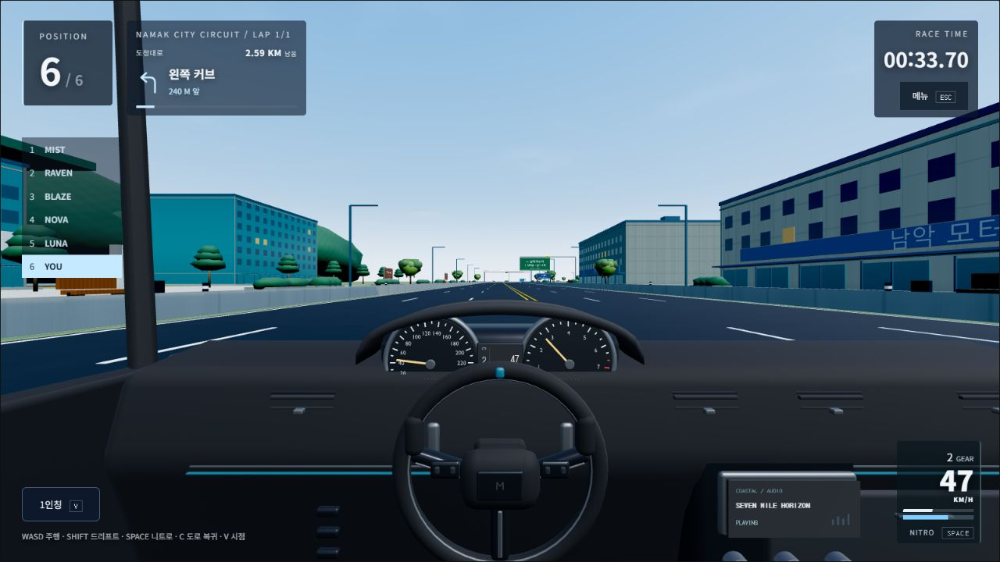

# 공식 게임 주소 연결 정리·접속 검증 · 2026-10-14

**[racing.mumuworld.com](https://racing.mumuworld.com/?track=namak&v=4359d7d)에서 최신 게임의 차고와 실제 주행을 확인했다.** 사용자의 ‘Wrangler로’ 요청에 따라 기존 CLI 인증으로 처리했다. 별도의 Cloudflare 로그인이나 권한 확대는 하지 않았다.

## 변경 및 현재 상태

- `wrangler.jsonc`의 기존 단일 custom domain에 `zone_name: mumuworld.com`을 명시했다.
- Wrangler 4.149.0 `triggers deploy`로 `racing.mumuworld.com`과 기존 `mumu-circuit`의 연결을 재등록했다. 최종 API 조회에서 해당 도메인만 존재하고 `enabled: true`, 부모 zone `active`를 확인했다.
- 게임 파일을 다시 업로드하거나 다른 코드를 섞지 않았다. 활성 게임 버전은 `156f359b-4940-4d49-9df3-c767bd880d9f` / 100%, 소스는 `4359d7dee328e94b6dc2c11d2e278bbaf6167043` 그대로다.
- 브랜치는 `codex/korea-circuits-progression-20261011`이다. 별도 남악 건축 작업·사용자 파일을 보존했고 main 변경·PR·병합·Vercel 배포는 없다.

## 실제 실행한 검증

| 검사 | 실제 결과 | 실행 위치 / 근거 |
| --- | --- | --- |
| 공개 DNS A | Cloudflare·Google 모두 `104.21.38.200`, `172.67.138.78` | Wrangler 원격 preview / `remote-probe.json` |
| 공식 HTTPS release | HTTP 200, 소스 `4359d7d` 일치 | 같은 원격 preview |
| 공개 파일 | **35/35 HTTP 200·SHA-256 일치**, 78,686,994 bytes | `remote-public-assets.json`, 기존 배포 preflight를 입력으로 사용 |
| 네 코스 진입 | 해안·남악·여수·성삼재 모두 HTTP 200, 정확한 JS entry | 동일 파일 검사 |
| 없는 모델 | HTTP 404 | 동일 파일 검사 |
| 실제 차고·주행 | 남악 차고 → 싱글 출발 → W 3,500ms → **92km/h** → V 1인칭 → Esc → 차고 | Codex IAB, 1280×720, native 키 입력 |
| 입력 해제·일시정지 | 가속 해제 후 92→66→47km/h 관측. 메뉴에서 W 1,000ms에도 시간 `00:33.88`·HUD 변화 없음 | `browser-smoke.json` |
| 브라우저 콘솔 | 실행 오류 **0**, 경고 **1** | 셰이더 상수의 극소 값 정밀도 경고 X4122. 실제 차고·도로·1인칭 렌더링 확인 |
| 도메인 상태 | `mumu-circuit` / enabled true / zone active | `current-domain-binding.json` |
| 게임 활성 버전 | 기존 최신 버전 100% 유지 | `deployments-summary.json` (전체 CLI 로그는 로컬 보관) |

원격 검사는 `wrangler dev --remote`의 임시 preview에서 공개 DNS·공개 게임 파일만 요청했다. 공개 파일의 경로/크기/해시만 전달했으며 인증 파일·토큰·사용자 자료는 읽거나 전송하지 않았다. 검사 후 자신이 시작한 dev 프로세스를 종료했다. 진단용 production Worker를 만들지 않았다.

게임·물리·UI 코드 변경이 없으므로 이번에는 긴 `npm run check`를 다시 실행하지 않았다. 이전 전체 시험이나 성능 수치를 이번 도메인 변경의 새 검사로 주장하지 않는다. 관련 범위는 Wrangler dry-run·연결 상태·정확한 공개 파일·실제 입력 흐름으로 검증했다.

## 실패·복구와 원인 판정

1. 로컬 CLI는 변경 전후 모두 이 hostname을 `127.0.0.1`로 해석하고 `ECONNREFUSED`를 반환했다. Cloudflare 지정 DNS 서버를 대상으로 한 로컬 nslookup도 같은 값이었다. DNS 캐시를 한 번 비워도 유지됐다.
2. 기존 Wrangler 인증의 DNS record 조회는 API 오류 10000(권한 부족)이었다. 추가 권한이나 새 토큰을 요구하지 않고 공개 DNS와 Worker domain 관리 범위로 진단했다.
3. 최초 단순 재등록으로 로컬 CLI 증상이 개선되지 않아 변경 전 domain binding을 보관하고 재생성을 시도했다. domain DELETE는 APIError(code 없음)를 반환했지만, 다음 읽기 조회에서 binding이 비어 있었다. 따라서 ‘아무 변경도 없었다’고 판정하지 않았다. 즉시 정상 Wrangler `triggers deploy`로 동일 hostname/service를 복구했고 마지막 API 조회로 복원을 확인했다. 최초 binding과 최종 binding의 인증서 ID는 달라졌다. 실패 로그와 복구 로그를 보존했다.
4. 독립된 Cloudflare 원격 네트워크에서 공개 DNS를 확인하자 정상 IP와 HTTP 200이 나왔다. 이후 공식 주소의 **실제 브라우저 접속·게임 로딩·주행이 성공**했다.

**원인은 아직 완전히 확정되지 않았다.** 원격 검사 이전의 공개 DNS 기준값이 없으므로 재등록이 잘못된 DNS를 고쳤다고 단정할 수 없다. 현재는 공식 도메인/공개 DNS/브라우저가 정상이며 이 PC의 로컬 CLI DNS 경로만 여전히 실패한다. hosts·어댑터 DNS·보안 보호·TLS 검증을 바꾸거나 우회하지 않았다. 로컬 실패 표본도 삭제하지 않았다.

## 확인 화면

## 미검증·다음 작업

- 이번 검사는 짧은 단일 PC 브라우저 흐름이다. 전체 랩·새 성능 측정·네 크기 UI·휴대폰 실기기·서로 다른 통신망의 온라인 대전은 재검증하지 않았다.
- 터미널 DNS 차이와 비치명적 셰이더 정밀도 경고를 기록했다. 공개 게임의 실패로 확대 해석하지 않았고 완전 해결을 선언하지 않는다.
- 다음 최우선은 사용자가 공식 주소로 실제 운전하고, 별도 기기/통신망 두 곳에서 온라인 1:1을 확인하는 것이다. 남악 건축 고도화는 별도의 미커밋 작업으로 남아 있다.

근거 폴더: `artifacts/domain-repair-20261014/`. 도메인의 인증서·DNS 자동 관리 방식은 [Cloudflare 공식 custom domain 문서](https://developers.cloudflare.com/workers/configuration/routing/custom-domains/), CLI 연결 방식은 [Wrangler 공식 명령 문서](https://developers.cloudflare.com/workers/wrangler/commands/workers/)를 참고했다.
