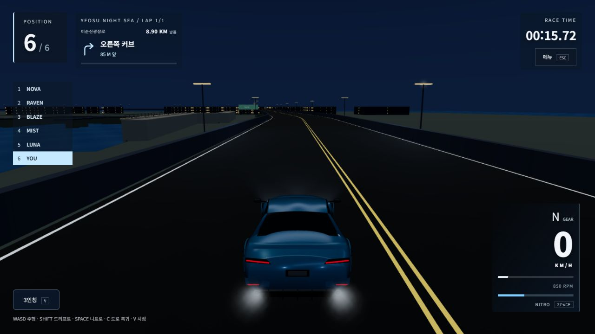
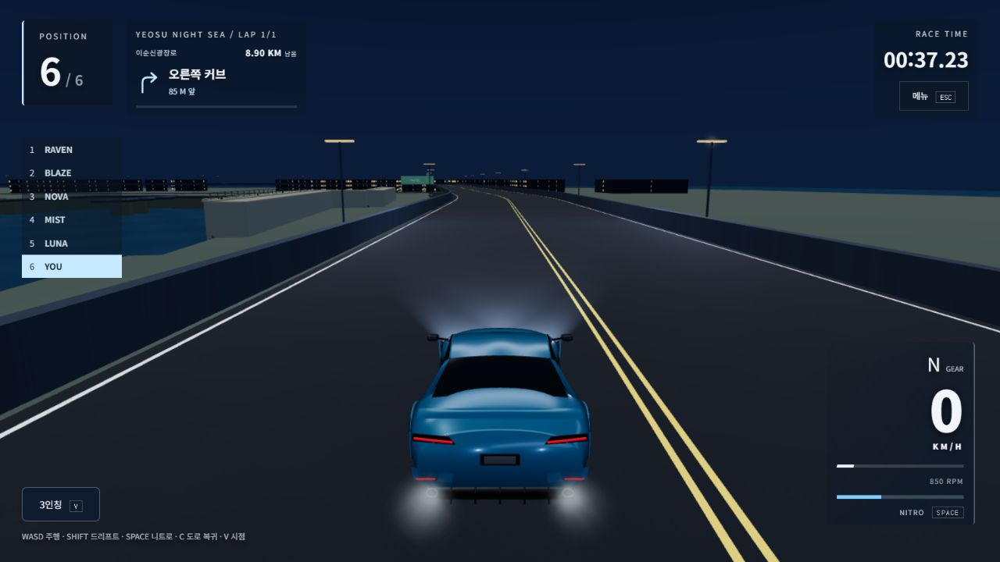

# 여수 야경·차량 반사 마감 / 핸들링 후보 보류 · 2026-10-25~26

**현재 제품에는 야경·반사 환경 개선만 남겼다. 주행 물리는 작업 전 상태로 복구했다.** 새 접지/드리프트 후보가 평지 목표는 만족했지만 기존 코스의 AI 완주를 악화시켜 중단 기준을 적용했다. 안전 복구본은 `npm run check` **509/509와 웹 빌드**를 통과했다.

브랜치 `codex/korea-circuits-progression-20261011`, HEAD `7f75155` 유지. 기존 REA 차체·카메라·접촉 변경과 사용자 자료를 보존했고, 이번 커밋·푸시·PR·main 병합·운영 배포는 하지 않았다. [검증한 로컬 웹 빌드](http://127.0.0.1:5207/?track=yeosu).

## 현재 적용한 변경

- 여수의 노면·차체가 검게 묻히는 문제를 줄였다. 밤 ambient/sun/environment/exposure를 .38/.12/.26/.88에서 .62/.24/.55/1.02로, 기존 가로등/헤드라이트 강도를55/34에서120/180으로 조정했다. 하늘/안개색은 유지했다.
- 야간 노면에만 차가운 색을 적용했다. 해안·남악 낮 노면의 RGB(.018,.022,.027), 도로/충돌/경로 정점은 그대로다. 기존 바다 반사의 폭과 끊어진 빛의 명암을 다듬었다. SSR/광선 추적 반사가 아니다.
- 도장 환경 반사강도1.1과 스튜디오의 채움/윤곽광을 조정했다. **도장 roughness/metalness/coat roughness는 Blender 원본과 같은 .30/.27/.12**, 유리는.16으로 유지했다. 새 형상·사진 텍스처·고무 override를 넣지 않았다.
- 조명6·그림자맵0·추가 반사패스0 유지. 미적용 후보의 같은 출발 장면에서는 드로443·삼각형850,366개였다. 최종 사진은 AI가 더 멀리 진행한 시각(174드로·199,420삼각형)이므로 정적 사진의 호출 수로 성능을 직접 비교하지 않는다. 자산/기하 보존과 조명/패스 예산은 단위 시험으로 확인했다. Blender/GLB 원본을 새로 제작한 작업이 아니며, AAA/실사 완성으로 표현하지 않는다.

| 변경 전 | 안전 복구 후 최종 웹 빌드 |
|---|---|
|  |  |

같은 위치/카메라의 화면 영역에서 가중 sRGB8비트 코드값 평균은 도로18.04→42.54, 차체50.95→93.20, 하늘24.18→24.18이었다. 모니터 휘도나 사진 일치도 점수가 아니다. [실측 영역·수치](../artifacts/driving-visual-polish-20261025/visibility-safe-final.json).

## 실제 실행한 안전 복구본 검증

- **npm run check: 509/509**, 실패/취소/건너뜀0, 테스트591.226초·명령603.969초·Vite7.16초. 기본 concurrency2를 유지하고 Node heap384MiB만 지정했다. 테스트 수치/완주 제한은 낮추지 않았다. [원시 로그](../artifacts/driving-visual-polish-20261025/npm-check-safe.log) · [실행 결과](../artifacts/driving-visual-polish-20261025/npm-check-safe-result.json).
- 4코스×3난이도×1/3랩의 맑음24레이스144대, 비14레이스84대, 합계 **38레이스228대 전원 완주·노면 아래 추락0**. 교통6대 포함3상황도 전체 검사에서 통과했다. 실제 실행은 Windows 로컬 CPU/Node Rapier WASM이다. 원시 스크립트에 남는 Colab 장치 문자열은 과거 하드코딩 메타데이터이며 이번 Colab 사용 증거가 아니다. [정리한 레이스 결과](../artifacts/driving-visual-polish-20261025/race-regression-safe.json).
- 주행 물리/액션/튜닝/레이스 시뮬레이터4파일은 변경 전 사본과 바이트까지 동일하다. 이전 REA의 시각 차체 스프링과 카메라/충돌 표현을 유지했다. [물리 복구 SHA 확인](../artifacts/driving-visual-polish-20261025/safe-physics-match.json).
- 최종 production 웹 빌드에서 키보드1.2초 가속32~33km/h, 실제 포인터 브레이크1.3초로 정지·접촉4, 메뉴에서 입력 전부0, 재개·1인칭 전환·차고 복귀를 확인했다. keyup 직후 HUD 샘플에는 이전 throttle1이 남았으므로 그 한 표본을 즉시 해제 증거로 사용하지 않는다. 단위 시험과 후속 메뉴/포인터 검수를 함께 기록했다.
- 1280×720 /1024×768 /844×390 /667×375의 버튼6개, 최소68/57.6/44/44px, 박스 잘림·버튼간/HUD 겹침0. 844/667에서는 화면 변경 일시정지 뒤 실제 주행 재개·입력0도 따로 확인했다. 화면 크기 에뮬레이션이며 실기기 검증이 아니다. [실측](../artifacts/driving-visual-polish-20261025/ui-safe-sizes.json) · [브라우저 결과](../artifacts/driving-visual-polish-20261025/production-browser-safe.json).
- 최종 브라우저 console 오류 0건. 경고는 아래 실제 결과에 구분한다. 빌드의 기존 큰 JS chunk 경고는 남았다.

## 용량과 보존

- 전체 배포 파일37개: **80,118,722→80,118,796B(+74B)**. 양쪽의 .js/.css/.html/.json/.svg를 같은 gzip level9로 재계산하면2,128,589→2,128,649B(+60B). 처음 서로 다른 gzip 범위를 섞은 계산은 별도 파일로 보존하고 이 수치로 정정했다.
- 여수 차고의 첫 읽기20리소스: **21,192,436→21,192,494B(+58B)**, 최종 transfer21,198,494B/cache0/크기 미상0. HTML·BGM·다른 코스 로딩은 제외한다. 로컬 브라우저 Resource Timing 수치로 실제 모바일망 첫 로딩 시간 주장이 아니다.
- 공개 모델·지도·음원·경로29개와 블로그 사진20장 SHA 변경0. 비밀키/환경 파일은 읽거나 출력하지 않았다. 원래 사용자 변경을 지우지 않았다. 후보와 변경 전 사본은 이번 검증을 재현하는 자료로 보존했다.

## 성능과 한계

같은 PC(i5-1135G7/약15.73GiB RAM), IAB/1280×720/DPR.75/낮음/맑음/보통6대/3인칭/표준 움직임/고스트 끔/출발 후30초. 무거운 검사를 끝낸 뒤 GPU timer/frozen/profile 훅 없이 측정했다. **DEV 소스의 측정이며 운영 빌드의 장시간 FPS가 아니다.**

- 변경 전 남악 A1/A2: 평균16.685/16.676, p9516.9/16.8, 최대33.6/33.3ms, >50ms0. 최종 안전 복구본은 평균16.788/p9516.9/최대33.4ms, >50ms0/버린 시뮬레이션0, CPU 제출 평균6.276/p959.0/최대32.4ms. 마지막 진행829.811m도 기준본과 같다. +2ms 제한 안이다.
- 미적용 후보의 여수는 A/B/A p9516.8/18.7/16.8ms였고 B에서 **최대57ms·50ms 초과3회**가 있었다. 추가 표본도 삭제하지 않았다. 정차 B의100.1ms 스파이크와 A2 정차 조건 실패도 보존했다. 이는 현재 안전 복구본 수치와 합산하지 않는다.
- 정차 시도 중 준비 오버레이 아래의 자동 페달 클릭이 반영되지 않은 표본2개는 정차 비교에서 제외하고 남겼다. 정차 A/B/A 완료 또는 조명만의 인과적 비용을 주장하지 않는다. 반복 검수 중 가용 RAM이422MiB까지 줄어 검수 탭/비교 서버를 닫았다. 모든 기기에서 끊김이 없어졌다는 주장도 하지 않는다.

## 보류한 핸들링 후보와 실패 근거

후보는 실제 이동 속도로 조향/복구를 판단하고 사람 접지를 낮췄다. 평지에서 실제 가속 뒤8종×7상황=56개를 측정해 아래 목표를 만족했다. **현재 앱에 적용된 수치가 아니다.** 80km/h 선회는 페달로 속도를 유지한 시험, 드리프트는 보정 켬90km/h·조향+사이드브레이크1.5초다.

| 차량 | 최대 옆가속도 G 전→후 | 드리프트 종료 km/h 전→후 | 최대 yaw °/s 전→후 |
|---|---:|---:|---:|
| supra | 3.46 → 1.74 | 10.08 → 47.94 | 179.30 → 104.89 |
| slk | 3.31 → 1.74 | 11.89 → 47.11 | 179.05 → 108.86 |
| mustang | 3.33 → 1.67 | 10.79 → 49.85 | 171.86 → 100.28 |
| porsche911 | 3.76 → 1.74 | 6.78 → 49.34 | 185.67 → 101.32 |
| gtr | 3.68 → 1.73 | 12.28 → 45.82 | 190.08 → 105.45 |
| rx7 | 3.31 → 1.74 | 5.45 → 49.73 | 171.78 → 104.26 |
| m3 | 3.60 → 1.73 | 12.40 → 45.52 | 188.34 → 106.37 |
| huracan | 3.90 → 1.73 | 11.04 → 46.62 | 199.37 → 105.69 |

후보는8종 가속/제동 거리를 바꾸지 않았고4코스·교통0·1랩24대도 완주했다. 그러나 전체에서는 **527건516통과/11실패**였다.

1. 해안 쉬움3랩: 후보AI4대가 약17.84km에서 정체해1260초에 미완주. 같은 제한/입력의 원래 코드는6대610.25~634.90초에 완주해 악화를 확인했다.
2. 여수 교통6대 포함 쉬움/맑음/1랩, 보통/비/3랩도 전원 완주하지 못했다. 시간을 늘리거나 순간이동·진행 거리 보정으로 통과시키지 않았다.
3. Blender export와 runtime 코팅 일치 검사가8종에서 실패했다. 이 계약을 완화하지 않고 원래 도장·유리값으로 복구했다. 관련52/52 재검사와 최종509/509가 통과했다.

옛 '무조건 더 작은 반경' 시험과 새1.7G 목표의 충돌, 앞 방향/실제 이동 속도 기대값 수정, 첫 전체 명령 중단도 보존했다. 해당 물리 변경과 새 물리 시험은 현재 제품에서 제거하고 `candidate/` 연구 사본으로 남겼다. [실패/복구](../artifacts/driving-visual-polish-20261025/rollback.json) · [같은 조건 원래 코드](../artifacts/driving-visual-polish-20261025/completion-gate-before.json) · [미적용 후보 전체 결과](../artifacts/driving-visual-polish-20261025/npm-check-final-result.json).

원본 probe/weave 전후와56상황·랩/금메달/가감속 원시는 artifacts/driving-visual-polish-20261025에 있다. 금메달은 낮추지 않았다. 보수적인 니트로 봇도 여수만 금메달을 달성했으므로 다른 코스 금메달 가능성을 입증했다고 주장하지 않는다. 기존 사용자 기록·고스트도 초기화하지 않았다.

## 직접 본 공식 레퍼런스

- [Toyota GR Supra](https://www.toyota.com/discontinued-vehicles/grsupra): 갤러리 주소가 이 페이지로 이동했다. 공식 프로모션 사진의 도장 하이라이트·짙은 유리/고무 대비를 확인했다. CAD/셰이더/사진 텍스처 복제가 아니다.
- [여수시 공식 밤바다](https://www.yeosu.go.kr/tour/leisure/bambada/night_sea): 짙은 하늘/주변부, 다리 조명과 넓고 끊어진 수면 반사를 직접 확인했다. OSM 기반의 기존 레이스용 경로와 랜드마크를 보존했다. 실제 거리·지형·조명 위치의 측량 복제를 주장하지 않는다.
- text fetch timeout/403·image search 결과 없음 뒤 실제 브라우저에서 확인했다. [출처/확인 화면](../artifacts/driving-visual-polish-20261025/references.json). 저작권 사진/상표를 새 게임 자산으로 추가하지 않았다.

## 다음 우선순위

가장 먼저 새 접지로 차량 상호작용이 달라질 때 **정차/벽 접촉 뒤 AI가 차로를 찾지 못하는 원인**을 분리해야 한다. 사용자 중단 기준에 따라 이번에는 물리 후보를 다시 조정하지 않았다. 실제 사람 운전·휴대폰/태블릿·별도 통신망 온라인, 높은 품질 장시간 프레임은 남았다. 차체 형상/배경/실내/VFX 미술 원본의 추가 확장도 그 뒤다.

## 최종 브라우저 추가 기록

- 최종 DEV 남악 보통6대 **85.725초**, AI79.825~83.933초, 전 차량복귀0·접촉4. 완주→동메달/실제 해금→결과에서 차고 복귀를 확인했다. [실제 결과](../artifacts/driving-visual-polish-20261025/browser-safe-race.json) · [결과→차고](../artifacts/driving-visual-polish-20261025/browser-safe-flow.json).
- 최종 여수 낮음30초: 평균17.331/p9517.1/최대66.6ms, >50ms 2회, CPU 제출 평균5.362/p958.5/최대60.7ms, 버린 시뮬레이션0. 기준p9516.8 대비+0.3ms로 +2ms 제한 내지만 **66.6ms의 긴 프레임2회는 남았다.** [원시 표본](../artifacts/driving-visual-polish-20261025/performance-safe-yeosu.json).
- 남악30초의 시작/마지막 드로415/503·삼각형815,497/957,059는 기준과 최종이 같고 진행829.811m도 같다. 여수의30초 첫/마지막 드로는 기준/최종 모두366/396, 진행523.899m로 일치한다. 그래도 별도 시각의 단일후측정이며 운영/실기기 전반 성능 개선을 단정하지 않는다.
- 최종 production console 오류0, WebGLProgram 부동소수 정밀도 경고1건(표시/셰이더 컴파일 실패 아님). 같은 하드웨어의 앞선 검수에도 있던 종류이며 이번에 해결했다고 하지 않는다.
- 최종 제품/시험 입력224개 SHA는 전체 통과한 validation-safe와 모두 같았다. 블로그20장·공개29자산 보존, 브랜치/HEAD 유지. 로컬 미리보기5207만 열었고 운영에는 반영하지 않았다.
