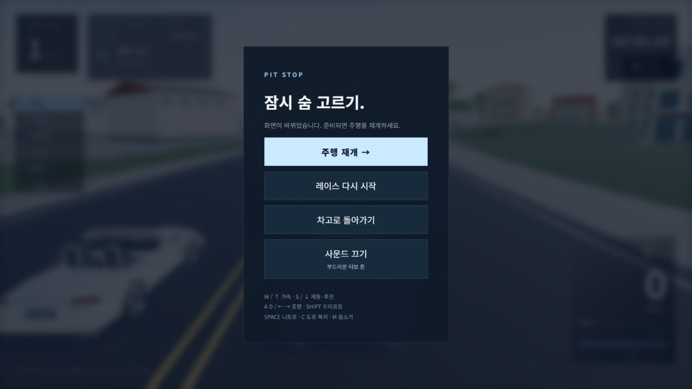

# 차량별 엔진 소리·가속 응답 · 2026-10-10

## 변경 결과

같은 엔진 음색을 사용하던 차량 8종에 서로 다른 합성 음색을 연결했다. 실제 변속기 RPM·부하·변속 상태로 소리를 구동하며, 바퀴 회전이나 HUD 속도만 보고 엔진 회전수를 꾸미지 않는다. 녹음 파일·마이크·외부 음원 다운로드는 사용하지 않는다. **실차 녹음 재현이 아닌 게임용 합성음**이다.

| 차량 | 합성 음색 | 페달 응답 시간 | 변속 동력 중단 | 직선 0→100km/h |
| --- | --- | --- | --- | --- |
| GR Supra | 부드러운 터보 톤 | 0.090초 | 0.18초 | 4.03초 |
| SLK Roadster | 경쾌한 로드스터 톤 | 0.130초 | 0.22초 | 4.92초 |
| Mustang GT | 낮고 굵은 머슬 톤 | 0.140초 | 0.24초 | 4.18초 |
| Porsche 911 | 건조한 스포츠 톤 | 0.085초 | 0.16초 | 3.88초 |
| Nissan GT-R | 깊은 트윈터보 톤 | 0.100초 | 0.15초 | 4.00초 |
| Mazda RX-7 | 높고 매끈한 로터리 톤 | 0.075초 | 0.20초 | 3.64초 |
| BMW M3 | 선명한 스포츠 세단 톤 | 0.095초 | 0.18초 | 4.23초 |
| Lamborghini Huracán | 날카로운 고회전 톤 | 0.065초 | 0.13초 | 3.13초 |

수치는 게임의 조작감 조정과 실제 로컬 물리 시험 결과다. 제조사 성능·엔진 구성·실차 변속기 데이터로 간주하지 않는다. 페달 응답 시간은 토크가 목표 부하를 따라가는 지수 응답의 시간상수이며 입력을 지연해서 차단하는 시간이 아니다.

## 구현

- 차별화: 엔진의 배음 분포·기본 진동수·저음·흡기 소리·필터 밝기를 차량마다 분리한다. 같은 RPM에서도 음색이 다르다. 차량 선택만으로 AudioContext를 만들지 않으며 출발/사운드 버튼 동작 때 생성·재개한다.
- 변속: 실제 변속기 `shifting` 상태 동안 엔진 볼륨을 낮추고 짧은 변속 소리를 낸다. 가속·감속에 따른 RPM을 부드럽게 잇는다. 니트로·풍절음·타이어 미끄러짐·충돌 레이어는 유지한다.
- 물리: 페달 응답·토크 최고점·토크 분포·변속 동력 중단·엔진 브레이크를 8종별로 연결했다. 차체 자세·타이어 지지·충돌체·맵·카메라를 인위적으로 흔들지 않는다.
- 수프라의 새 토크 분포는 산길 이음새 시험에서 최대 수직 가속도 89.28m/s²로 회귀했다. 기존 토크 곡선·페달 응답·변속·엔진 브레이크 수치를 유지해 같은 시험에서 38.65m/s²로 돌아왔다. 수프라의 음색은 새 프로필이며 주행 튜닝은 기존 검증본이다. 실패 기록은 `check-rebuild-failed.log`, 수정 후 집중 검사는 `mountain-recheck.log`에 보존했다.
- 소리 제어: 메뉴에 터치 가능한 켜기/끄기 버튼과 현재 차량 음색을 표시한다. 키보드 M도 유지한다. 음소거는 레이스 재시작과 차고/차량 변경에도 유지한다. 새로 페이지를 열면 기본 설정으로 시작한다.
- 일시정지·결승·차고에서는 전체 출력이 내려간다. 도로 복귀 때 RPM 응답·변속 이력을 초기화한다. Web Audio를 사용할 수 없으면 오류 상태와 재시도 버튼을 표시한다.
- 자원: 하나의 AudioContext와 고정된 오실레이터/노이즈 소스를 재사용한다. 부하·스키드·충돌 소리가 겹칠 때를 위해 출력 컴프레서를 추가했다. 실제 모든 기기의 출력 왜곡이 없다고 보장하는 것은 아니다.

## 검사와 근거

- 신규 집중 시험 5개: 8종 배음 구분·실제 RPM 연결, 응답 초기화·동일 시간 동결, 실제 변속 동력 중단과 엔진 브레이크, 단일 오디오 그래프 재사용·출력 차단·정리, 8종 실제 Rapier 가속·변속·코스팅.
- 평탄한 직선에서 8종 모두 네 바퀴 접지를 유지하고 변속했다. 가속 중 차체 기울기 0, 가속 페달을 놓은 뒤 1초간 속도 약 2.58~3.78km/h 감소를 관찰했다. 이 직선 결과로 산길·연석 진동이 모두 없어졌다고 판단하지 않는다.
- 근거: `artifacts/engine-feel-20261010/targeted.log`, `physical-fleet.json`. 신규 검사는 `npm run check:race`와 `npm run check:rebuild`에 포함했다.
- 최종 전체 회귀 검사 **136개와 웹 빌드 통과**. AI 5대의 실제 전체 코스 완주와 8종의 접촉 없는 직선 추월도 다시 통과했다. `check-rebuild-final.log`에 기록했다. 짧은 화면의 메뉴 간격을 마지막으로 조정한 뒤 빌드를 다시 수행하고 가로·세로 화면을 다시 확인했다(`final-style-build.log`).
- 브라우저에서 수프라가 73km/h·2단·4194RPM에 도달했고 실제 오디오 변속 이력 1회를 확인했다. Web Audio 상태는 `running`이었다. 일시정지에서 출력 비활성, 음소거 후 재시작·8종 선택/출발에도 꺼짐 유지, 도로 복귀 후 이력 초기화를 확인했다.
- 휴라칸 터치 GAS 주행 약 83km/h·네 바퀴 접지·버튼 해제 후 입력 0을 확인했다. 니트로·도로 복귀 후 켜진 오디오 출력 상태도 확인했다. 화면 회전 때 일시정지·입력 해제·출력 차단이 유지됐다.
- 화면 에뮬레이션 390×844, 844×390와 기본 1280×720 메뉴에서 사운드 버튼을 확인했다. 작은 가로 화면에서 추가 버튼 때문에 스크롤이 생겨 간격과 음색 문구를 줄인 뒤 주요 버튼이 함께 보이는 것을 확인했다. 실제 휴대폰 시험은 아니다. 읽은 브라우저 오류 로그는 0개였다.
- 브라우저 상태/화면: `browser-verification.json`, `menu-portrait-final.png`, `menu-landscape.png`, `menu-desktop.png`.

## 범위와 다음 작업

로컬 웹 구현이다. 공개 사이트를 갱신하지 않았다. 오디오 신호·그래프 연결 검증과 사람이 헤드폰/휴대폰 스피커로 듣는 음질 평가는 구분한다. 실차처럼 들린다는 청감 검수, 사람의 전체 레이스 운전, 실제 휴대폰의 장시간 발열·다중 터치 검수는 남아 있다. 다음 기능은 개인 최고 기록 저장과 결과 화면이다.
