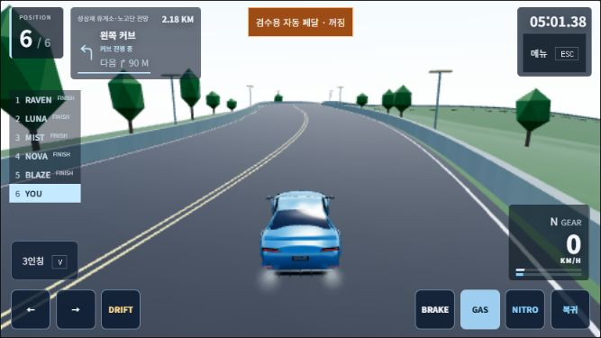

# 네 코스 최적화·연속 커브 안내 · 2026-11-04

사용자 재개 결정으로 이전 보류 범위 중 장식 계산과 코스 안내를 분리해 개선했다. 안정 물리·라이벌·메달·경로·충돌·모델은 유지했다. 이전 실패 후보 묶음을 통째로 복원하지 않았다. 로컬 작업이며 새 커밋/푸시/PR/main/운영 배포는 하지 않았다. 기존 PC DNS 복구 문서와 hosts 설정은 보존했다.

## 변경

- **성삼재:** 정적인 산 능선의 경계 구를 생성 시 계산한다. 48회 갱신 시험에서 반복 경계 구 계산432회→0회. 산·도로의 형상과 장식 예산은 동일하다.
- **남악:** 0.2초 간격 장식 갱신의 임시 구·정렬 배열·후보 객체를 재사용한다. 20회 갱신에서 구 객체20개→1개. 월드 변환·품질 전환·가시성·처분을 확인했다.
- **해안·여수 포함 공통:** 높은 품질의 무한거리 모드에서 불필요한 거리 계산을 생략한다. 100장식×120프레임 시험에서 거리 계산12,000회→0회. 매 프레임 원래 가시성 복원은 유지하고, 유한 거리·비정상 카메라·NaN 경계값은 기존 경로로 처리한다.
- **게임성:** 다음 독립 커브를 짧게 예고하고, 고속에서는 최대420m까지 앞서 알려준다. 같은 커브의 연속 점을 다음 커브로 오인하지 않는다. 급커브 경고도 속도에 맞추되 조작/물리에는 영향을 주지 않는다. 두 개의 정수 인덱스 배열을 경로별로 한 번 만들고 안내 시 경로 전체를 재탐색하지 않는다.
- **가독성:** 실제667×375에서 새 안내7px 문제를 발견해 최소10px로 보완했다. 기존 순서 기반 색상 규칙 때문에 브레이크 글자가 어두운 배경에 어둡게 표시되던 문제도 의미 있는 `TouchBrake` 선택자로 수정했다. 작은 화면에서 다음 안내와 순위표의11.525×4.9px 겹침을 발견해 짧은 가로 순위표에17px 공간을 더 확보했다.

## 프레임 측정

로컬 IAB,1280×720, 같은 코스/3인칭/보통6대/맑음, 고스트 없음. 높은 품질 DPR≈1.0, 낮음 DPR0.75. 기존 QA 자동 페달의30초 제품 기준 측정을 UI로 실행했다. GPU 타이머·frozenComparison·프로파일 훅은 꺼져 있다. 원시 구간·CPU 제출·드로/삼각형 수·포커스·시간 손실을 모두 보존했다. CPU/RAM/다른 작업의 영향을 완전히 통제한 실험실 측정이나 실기기 검증은 아니다.

| 분리한 변경 | A1 p95 | B p95 | A2 p95 | 주의 |
| --- | ---: | ---: | ---: | --- |
| 성삼재 경계 구 재사용 |33.4|34.0|33.4|동일DPR A2/B2/A3. B CPU 평균13.56ms로 악화한 표본도 보존 |
| 남악 장식 재사용·높음 |33.3|33.3|33.4|첫 A 최대633.3ms·시뮬레이션 손실0.384초 |
| 해안 공통 거리 생략 |33.3|33.3|33.4|종료 고정 스텝 차이로 끝점981.81/979.33/979.33m |
| 여수 공통 거리 생략 |16.8|16.9|16.8|첫 A/B 시간 손실0.817/0.167초로 종료 구간 불일치 |
| 여수 새 안내만 |16.8|16.9|16.8|첫 B 최대166.7ms·>50ms11회. 재측정 B2 최대17.2ms·>50ms0회 |
| 남악 낮음 최종 조합 |16.8|16.9|16.8|첫 B 최대216.7ms·>50ms9회. B2 최대50.0ms·>50ms0회 |

단위는ms. 성삼재 첫 A1은 viewport 적용 전 DPR1.25였으므로 인과 비교에서 제외했다. 표본을 삭제하지 않았으며 위 성삼재 행은 이후 동일DPR의 새 A/B/A다. 진행 구간/기준본 편차와 긴 프레임 때문에 고정된 FPS 개선율이나 원인 확정을 주장하지 않는다.

높음 최종 조합(이후 글자/색 보완 전)의30초 결과:

| 코스 | 평균 |p95|최대|>50ms|CPU 제출 평균|
|---|---:|---:|---:|---:|---:|
|해안|21.677|33.4|50.1|1|13.212|
|남악|16.978|16.8|49.9|0|9.778|
|여수|16.667|16.8|17.5|0|3.941|
|성삼재|17.658|33.2|50.1|1|8.996|

마지막10px 안내·브레이크 대비 보완을 포함한 낮음 재측정은 **남악 평균16.667/p9516.9/최대17.2/>50ms0/CPU4.051ms**, **여수 평균16.667/p9516.9/최대17.0/>50ms0/CPU3.462ms**였다. 두 조건 모두 시뮬레이션 손실0이며 이전 동일 구간 끝점과 일치했다. 남악 낮음의 p95 증가는0.1ms로2ms 기준 이내다. 코스 형상이나 품질 예산을 낮춰 시험을 통과시키지 않았다.

## 자동 검사·완주·화면

- 관련38/38, 가독성 후속 입력/UI8/8을 통과했다. 새 시험은 좌우 부호, 실제 네 경로의 첫 커브, 다음 독립 커브, 순환 이음새, 마지막 랩, 비정상 속도, 캐시 읽기량, 가시성/거리/품질 전환/처분을 확인한다.
- 첫 전체 `npm run check` **549/549·빌드4.65초**, 실행615.003초. 최종 전체 재검사도 **549/549·빌드4.00초**, 실행581.031초로 통과했다. 코스 안내·최적화 JS는 재검사 시작 전232입력 일치를 확인했다. 이후 순위표 간격 CSS만 최종 빌드 이전에 보완하고, 별도 입력/UI8시험과 네 크기 실제 화면을 다시 확인했다. 최종 작업 폴더/검사본232입력 내용은 모두 같다.
- 실제 브라우저 QA 페달의 남악1랩: 플레이어85.725초, 라이벌79.825/80.175/82.317/82.658/83.933초,6대 전원 완주. 결과·동메달·해금·차고 복귀 확인. 검수용 전용 localhost 저장소이며 사용자 운영 기록은 바꾸지 않았다.
- 실제 성삼재에서 현재 오른쪽 커브·다음 왼쪽230m 안내를 확인하고, 자동 페달을 끈 뒤 수동 제동했다. 실제 도로 위 화면이며 안내 내용을 주입한 시안이 아니다.
- 독립 읽기 전용 검토에서 P1/P2 결함은 찾지 못했다. 검토자는 네 경로의0/180/260km/h 다음 커브34,455건을 별도 순차 탐색과 비교해 불일치0건으로 보고했다. 작은 글자 지적은 실제 화면에서 재현·수정했다.

## 실패·수정 이력과 한계

1. 첫 성삼재 비교의 DPR이 달랐다. 원시 자료를 유지하고 같은DPR로 새 A/B/A를 실행했다.
2. 무한거리 생략이 NaN 경계 구를 잘못 노출하는 반례를 추가했다. 생성 시 경계값 확인으로 기존 fallback을 유지하고 관련 시험을 통과했다.
3. 여러 조건의 긴 프레임은 재측정에서 재현되지 않았지만 원인을 확정하지 못했다. 평균/p95만 골라 보고하지 않고 최대·횟수·손실도 남겼다. 해안/성삼재 높음과 다른 PC의 장시간 성능은 계속 확인해야 한다.
4. 전체 검사 실행 폴더 실수를 즉시 중단했다. 검사 전 격리 사본 대비 기존 tracked artifacts 내용 변경0개·관련 프로세스 종료를 확인하고 중단 로그를 보존했다. 실행기에 격리 경로 강제 검사를 추가한 뒤 올바른 폴더에서 새 전체 검사를 실행했다.
5. 휴대폰/태블릿 실기기 멀티터치, 별도 통신망 온라인 대결, 모든 그래픽 품질/차종/장시간 조합은 이번 확인 범위 밖이다. 보류했던 접지/드리프트 물리 후보는 적용하지 않았다.

## 증거

[실행 계획](superpowers/plans/2026-11-04-map-polish-resume.md), 로컬 `artifacts/map-polish-resume-20261104/`의 변경 전 사본/session/ledger·원시 프레임·검사 로그·화면·회귀/용량/보존 보고서. 검사/미리보기는 Git 밖의 `D:/racing/.work/map-polish-resume-20261104/`에서 실행한다. 원본 Blender/GLB/경로·사용자 자료를 삭제하지 않았다.

## 최종 회귀·크기·초기 용량

맑음24·비14·교통3조건의 **41레이스246대 전원 완주·추락/이탈0**. 네 코스/세 난이도와 다중 랩이 포함되며 차량별 완주 시간/최저 높이/이탈 시간 등 전체 결과가 이전 안정본과 정확히 같다. 라이벌이나 메달 기준을 바꾸지 않았다. 실행은 로컬 Node/Rapier다. 수정하지 않은 일부 과거 시험 작성기에 남은 `Colab CPU` 라벨은 이번 실행 환경을 뜻하지 않는다.

| 브라우저 크기 | 실제 게임 영역 | 조작 버튼 | 최소 한 변 | 중앙 히트 | HUD 겹침/넘침 |
|---|---|---:|---:|---:|---|
|1280×720|1280×720|7|68px|7/7|0/0|
|1024×768|1024×576, 위아래 여백|7|57.6px|7/7|0/0|
|844×390|약694×390, 좌우 여백|7|44px|7/7|0/0|
|667×375|약667×375|7|44px|7/7|0/0|

실제 성삼재의 다음 커브가 나타난 상태에서 안내10px/줄 안에 들어옴·HUD 간 교차 면적·버튼 중심의 실제 최상단 요소·화면 밖 영역을 측정했다. 실패 DOM/캡처도 보존했다. 최종 production 웹 빌드의 여수1인칭에서도 네 크기7버튼·44px 이상·히트7/7·겹침/넘침0·입력0을 다시 확인했다. IAB viewport 검증이며 실기기나200% 확대 검증으로 표현하지 않는다.

최종 웹 빌드에서 포인터 가속66km/h, 키보드89km/h,1인칭, 수동 도로 복귀 후4접지, 메뉴 입력0·차고 복귀·재출발을 확인했다. 새 소스의 브라우저 오류0건. 화면 크기 변경 뒤 모든 페달/조향 입력이0으로 해제됐다. 물리 접지·충돌·조향 후보를 바꾸어 얻은 결과가 아니다.

- 공개29자산·물리/경로/AI 등 이번 범위 밖 기존280파일과 블로그20장 SHA를 보존했다. 원본 Blender/재생성 스크립트도 이번에 변경하지 않았다.
- 전체 정적 배포물37파일 **80,127,469→80,129,012B(+1,543B)**. 동일 JS/CSS/HTML gzip 합계 **+447B**. 이것은 전체 배포물이며 한 번에 모두 다운로드하는 양이 아니다.
- 새 localhost origin의 여수 차고 첫 로딩 Resource Timing 각20파일, cacheHits0/unknownSizes0: encoded **21,195,127→21,195,575B(+448B)**, transfer **21,201,127→21,201,575B(+448B)**. 로컬 precompressed preview 기준이며 공용 모바일망 로딩 속도로 일반화하지 않는다.
- 프레임 원시 표본은 총28회·실측840.597초. 나쁜 표본을 제외해 평균을 만들지 않았다. 마지막 순위표 간격 보완은 DOM 위치만 바꿨으며, 해당 CSS 이후 별도 프레임 비교는 추가하지 않았다. 낮음 마지막 측정은10px 글자·브레이크 대비 보완까지 포함한다.

**현재 로컬 미리보기:** [여수](http://127.0.0.1:5231/?track=yeosu), [남악](http://127.0.0.1:5231/?track=namak), [해안](http://127.0.0.1:5231/?track=coastal), [성삼재](http://127.0.0.1:5231/?track=seongsamjae). 제품의 메달 해금은 그대로여서 새 저장소에서는 성삼재에 메달1개가 필요하다. 성능/화면 검수용 DEV host만 전용 fixture로 출발을 허용했으며 운영 저장 데이터나 출하 빌드에 해금 우회를 넣지 않았다.

**다음 우선순위:** 실제 휴대폰/태블릿에서 다음 안내를 보면서 한 랩과 동시 입력을 확인한다. 그 다음 높은 품질의 긴 프레임을 고정 조건에서 추가 분리한다. 이번 결과는 모든 기기의 끊김 해소가 아니다. GitHub/운영 반영은 별도 배포 요청 범위로 남긴다.
