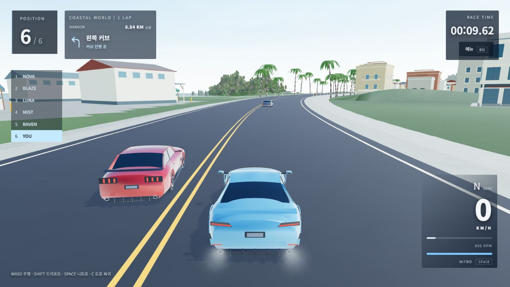

# AI 라이벌 추월·회피 · 2026-10-10

## 변경 결과

기존 AI는 앞차 속도에 맞춰 기다렸다. 이번 구현은 **따라가기 → 차선 이동 → 추월 → 복귀**를 추가한다. 플레이어 입력과 차량 형상·접지 물리는 유지한다. AI도 조향·가속·제동 입력으로 움직이며, 위치를 직접 바꾸거나 추월을 위해 순간 이동하지 않는다.

## 안전 판단

- 공유 계획기가 앞선 차량부터 0.2초마다 판단한다. 120Hz 물리 단계에는 조향·페달만 전달한다.
- 느린 앞차를 따라잡을 때 반대 차선의 차량, 뒤에서 빠르게 접근하는 차량, 마주 오는 차량을 2.6초 범위로 예측한다. 차량 길이·폭과 여유 간격을 사용한다. 표본 사이에 빠른 차량이 지나가는 경우도 상대속도로 충돌 시점을 계산한다.
- 다른 AI가 이미 이동 중이면 그 경로를 예약한다. 플레이어와 결승을 통과한 차량도 장애물로 판단한다.
- 차량 중심과 양옆의 실제 아스팔트 충돌체를 확인하고, 차 크기의 공간 검사로 벽·장애물을 찾는다. 잔디, 좁은 포장, 급커브, 공중에서는 새 추월을 시작하지 않는다.
- 정차한 앞차까지 거리가 9m 미만이면 새 추월을 시작하지 않는다. 여유가 있으면 낮은 속도와 짧은 조향 목표 거리로 우회한다. 앞차가 옆으로 움직이면 기존 추월 대상도 다시 충돌 예측에 포함한다.
- 새 차량이 끼어들면 초기에 원래 차선으로 포기하거나 제동한다. 추월한 앞차와 충분히 떨어진 뒤 복귀하며, 실제 복귀 위치에 도달해야 완료로 센다.
- 복귀 경로가 막히면 현재 차선 위치를 유지하며 전방 제동 규칙으로 달린다. 뒤차 앞에서 무조건 정차하지 않는다. 안전한 복귀 기회가 없으면 다른 차선에서 결승에 도착할 수 있다.
- 일시정지는 계획 시간을 멈춘다. 도로 복귀 후 선택된 차선으로 계획을 초기화하고, 재시작·차고 복귀 때 전체 예약을 비운다.

## 실제 발견·수정

1. 매 판단마다 부분 이동 위치에서 새 차선 이동 전체를 예측하자 정차한 앞차 옆에서 멈췄다. 처음 통과를 승인한 앞차가 차선을 유지하면 기존 전방 제동 규칙을 적용하고, 앞차가 횡이동하면 이 예외를 해제한다. 차량 8종의 10m 접근 시험으로 검증했다.
2. 실제 맵 3.06km 산길에서 GT-R이 복귀 중 멈추자 수프라·머스탱도 막혔다. 복귀를 미루고 현재 차선에서 진행하도록 수정했다. 같은 6대 전체 코스 시험을 다시 수행했다. 실패 기록은 `artifacts/rival-ai-20261010/course-diagnostic.log`, `full-course-stalled.json`에 보존한다.

## 검증

- 새로운 집중 시험 18개 통과: 빈 차선·옆차·마주 오는 차·뒤차·예약·급커브·공중·잔디·벽·접근 거리·끼어들기·추월 대상 횡이동·복귀 지연·일시정지·초기화.
- 차량 8종 각각 실제 Rapier 시험: 같은 차선 10m 앞의 정차 차량을 추월하고 복귀했다. 차량 접촉 0회, 플레이어 밀림 5cm 미만, 네 바퀴 접지와 두 차선 내부 주행을 매 단계 검사했다. 이 결과는 통제된 직선 시험에 해당한다.
- 실제 맵의 충돌체 160개를 사용한 플레이어 자동 운전 + AI 5대의 6.84km 완주 시험 통과. 순간 이동·자동 복구 없이 완주했고 실제 추월·복귀가 발생했다. 전체 맵에서 충돌이 절대 없다는 시험은 아니다.
- 상세 결과: `artifacts/rival-ai-20261010/targeted-final.log`, `full-course.json`. `npm run check:race`, `npm run check:rebuild`에 새 시험을 포함했다.
- 최종 전체 회귀 시험 131개와 Vite 웹 빌드 통과. 빌드에 기존 Three.js·Rapier 청크 크기 경고가 남아 있으며 빌드 실패는 아니다. `artifacts/rival-ai-20261010/check-rebuild.log`에 기록했다.
- 최종 실제 맵 시험에서 6대 모두 약 230~264초에 완주했다. 추월 시도 5회 중 복귀까지 완료한 것은 2회이며 나머지 차량은 다른 차선에서 결승에 도착했다. 기록의 시간은 물리 시뮬레이션 시간이다.
- 브라우저 1280×720 로컬 빌드: 정차한 플레이어 뒤의 RAVEN·MIST가 순서대로 추월·복귀했다. 15.17초 시점 두 차량 모두 완료 1회·AI 자동 복구 0회, 플레이어 충돌 0회·위치 유지였다. 일시정지 중 AI 상태와 시간이 그대로인 것도 확인했다.
- 브라우저 입력 흐름: 재시작 시 예약 초기화 → W+A 동시 가속·조향 약 26km/h → C 도로 복귀·입력 해제 → 메뉴 → 주행 재개·W+SPACE 약 42km/h/니트로 감소 → 차고 → SLK 선택·새 레이스 → 차고 복귀. 읽은 오류 로그는 0개였다. 실제 브라우저에서 사람이 전체 코스를 운전·완주한 검수는 아니다.
- 화면과 상태: `artifacts/rival-ai-20261010/browser-passing.png`, `browser-verification.json`.

## 관련 코드

| 파일 | 역할 |
| --- | --- |
| `src/rebuild/rivalPlanner.js` | 차량 간 추월 판단·경로 예약·복귀·입력 생성 |
| `src/rebuild/overtakeRoad.js` | 실제 포장·차량 공간 확인 |
| `src/rebuild/course.js` | 선택적인 정밀 조향 목표·속도 제한·제동 |
| `src/rebuild/runtime.js` | 물리 단계 연결·예약 초기화·AI 상태 계측 |
| `scripts/rival-ai.test.mjs` | 계획 반례·8종 실제 추월·전체 코스 검사 |

## 범위와 남은 검수

로컬 순수 웹 제작본에 적용했다. 공개 GitHub Pages 배포는 갱신하지 않았다. AI 예측은 제한된 시간과 도로 표본을 사용하므로 갑작스러운 플레이어 충돌을 항상 피한다고 보장하지 않는다. 사람이 전체 레이스를 운전하는 평가, 실제 휴대폰 장시간 성능·다중 터치, 도심 연석과 산길 착지 충격 검수는 남아 있다. 차량별 엔진 음색과 개인 최고 기록 저장은 후속 작업이다.
